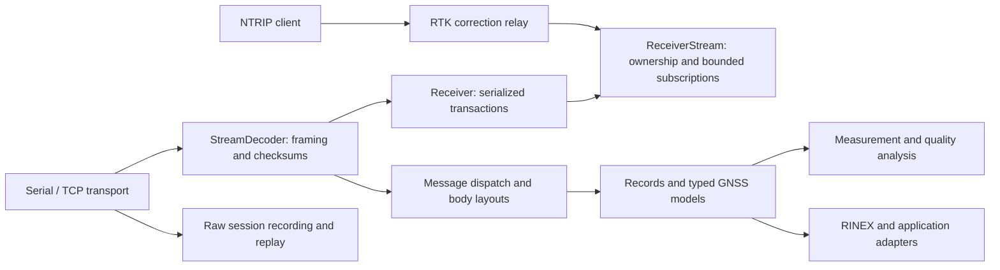

# Architecture and implementation review

Reviewed 2026-11-15. The existing layered library is a sound base for receiver
control and offline GNSS analysis. The changes from this review address
reproducible data loss, numerical errors, signal identity, protocol validation,
and repeated work in the decoding path.

The review combined repository-wide static checks and test execution with manual
inspection of the core acquisition, decoding, measurement, export, and workflow
boundaries. Specialized examples were also exercised by the integration suite;
their scientific models were not all independently re-derived.

## Responsibilities and data flow

| Area | Assessment and design contract |
| --- | --- |
| Transports and transactions | Keep byte I/O separate from command matching. Receiver operations are serialized; a running stream owns its receiver. Already buffered data is preserved, and a query response is not proof of measurement freshness. |
| Framing and body decoding | Checksums belong to framing; field interpretation belongs to layouts and typed models. Unsupported raw messages and ambiguous binary IDs must remain distinguishable. Recovery must not depend on serial/TCP chunk boundaries. |
| Commands and configuration | The immutable catalogue and validated command builders provide a useful single source of definitions. Temporary subscriptions restore prior settings; persistent configuration and reboots remain explicit workflow decisions. |
| Streaming and async APIs | Bounded subscriptions, drop counters, monotonic arrival times, and explicit ownership are worth preserving. Async operations wait for outstanding thread I/O during cancellation, preventing concurrent receiver access. |
| Time and solution quality | Retain time reference, status, and assumptions. GPS/BDT conversion and UTC leap offsets are explicit. Host completion time, correction forwarding age, measurement epoch, and receiver-reported correction age are separate quantities. |
| Observations and carrier analysis | Signal identity must preserve the L2C tracking flag. Process one native log from one antenna/session per measurement series. Compressed phases remain unavailable until their ambiguity is resolved. |
| Coordinates and numerical work | ECEF conversion must remain stable near both poles. Ellipsoidal and mean-sea-level heights are separate. Receiver standard deviations are estimates, not integrity bounds. |
| Corrections and rover workflows | NTRIP framing errors, retryable disconnects, receiver write failures, and application callback errors have different recovery policies. Receiving RTCM is not evidence that the receiver applied it. |
| Recording and exchange formats | Raw segments, checksums, gap events, and provenance are valuable. RINEX exports preserve omissions and metadata; external tools provide independent checks. |
| Packaging and applications | Lazy public imports keep experimental features and optional scientific dependencies outside the core API. The wheel contains the library; runnable examples remain in the source distribution. |

## Applied changes

| Finding | Previous behavior | Applied improvement |
| --- | --- | --- |
| Polar ECEF height instability | Computing height with `p / cos(latitude)` magnified rounding errors. At `(1e-8, 0, b + 10)` the reported height was about −209,730 m instead of 10 m. | Latitude iteration no longer divides by the cosine or estimated radius; height uses projection onto the ellipsoid normal. Tests cover both poles, below-sea-level heights, and geostationary altitude. An independent pyproj check uses ECEF inputs directly. |
| Loss of the next fragmented frame after corruption | A truncated binary frame could consume the first bytes of the next N4, OEM, RTCM, or NMEA frame. Recovery worked differently depending on read boundaries. | Recovery prefers complete checksum-verified frames, then preserves plausible incomplete candidates within the configured size bound. Candidate copies are capped by that bound. Regression tests exercise every split through the following frame. |
| L2 P(Y)/L2C observation collision | Both variants can share constellation, PRN, and native signal code 9; grouping silently selected one by C/N0. | `SignalKey.l2c_flag` preserves the distinguishing tracking-status bit. The zero-baseline reference selection and PPP diagnostic labels retain it too. |
| Mixed observation sources | Increasing epochs from `RANGE` and `RANGEH` could become one carrier series. | `sample_series()` rejects mixed native log names before interpreting their bodies, matching the existing RINEX and quality-audit isolation rule. |
| Exporter dependency in quality analysis | Observation auditing imported a private normalization function from the RINEX exporter. | Shared normalization now lives in `_observation.py`, used by both consumers. An import-boundary test prevents quality analysis from loading file exporters. |
| NTRIP chunk parsing and premature EOF | Python integer syntax admitted sizes such as `+2`, `0x2`, and `1_0`; a zero chunk ended the stream before its trailers were complete. | Chunk sizes require hexadecimal digits. Trailer consumption is bounded to 16 KiB, survives socket timeouts, and distinguishes incomplete responses from clean EOF. |
| Repeated catalogue scans | Every automatically identified receiver log scanned the complete catalogue. | A lazy index maps wire names and IDs to all candidate logs. Ambiguity checks remain intact; the cache contains only static catalogue entries, not arbitrary received names. |

The NTRIP size and completion rules follow
[RFC 9112 section 7.1](https://www.rfc-editor.org/rfc/rfc9112.html#section-7.1).
The coordinate reference comparison uses
[pyproj's Transformer API](https://pyproj4.github.io/pyproj/stable/api/transformer.html).

A local Python 3.13 benchmark of 2,000 BESTNAV body decodes, best of five runs,
improved from approximately 0.215 s to 0.066 s after indexing. This measures one
decoded fixture in memory; it is not a receiver throughput or latency guarantee.

## Compatibility

`SignalKey(system, prn, signal)` still works: `l2c_flag` defaults to `False`.
Equality, ordering, and dataclass serialization now include that flag. Callers
that construct keys for L2C samples or persist key dictionaries should retain it.
Series containing both variants now contain two keys instead of silently losing
one variant.

Mixed observation log names now raise `ValueError` in `sample_series()`. Split
captures by source before calling it. A log name cannot identify the physical
receiver or session; callers must still preserve that provenance and a stable
GLONASS frequency assignment. Independent recordings should not be concatenated
into a carrier arc merely because their log names agree.

Malformed chunk sizes and incomplete final trailers are now errors. Valid
chunk extensions and complete trailers remain supported. No runtime dependencies
were added, and the binary-ID ambiguity and lazy-import contracts are preserved.

## Validation and next work

Final local results on Python 3.13: **4,117 passed, 82 skipped, 1 expected
failure**. Ruff lint and formatting, strict mypy, source/wheel builds, and the
CLI help smoke test passed. The expected failure is GeoRinex's handling of blank
intermediate GPS navigation fields; its observation comparison also emitted two
NumPy warnings. Skips require receiver hardware, external client/RTKLIB/PROJ
executables, or separately prepared PPP datasets.

Run the development checks in the README, then the independent reference tests
with the optional reference tools installed. The test suite includes packaging,
local TCP/NTRIP integration, cancellation, configuration restoration, captured
wire data, observation exports, and numerical comparisons.

The highest-value next validation is a hardware soak at the intended output
rates, including receiver reboot, UART disconnect, correction loss, and slow
subscriber recovery. Track queue drops, decoder errors, measurement gaps, and
end-to-end correction age. No receiver was selected during this review.

Keep RTKLIB conversion and published PPP reference checks in CI. Those need
external executables/datasets beyond the ordinary unit suite. Firmware-specific
timestamp meanings, undocumented messages, absolute accuracy, and antenna phase
alignment require independent receiver/reference evidence; passing replay tests
does not establish them.

Further architectural work should follow measured pressure: extract transaction
internals from the receiver facade if its responsibilities grow, carry explicit
session provenance into cross-recording analysis, and use rank-revealing QR/SVD
if scientific workloads demonstrate ill-conditioned least-squares failures.
Avoid changing the acquisition and ownership model without throughput and
cancellation measurements.
